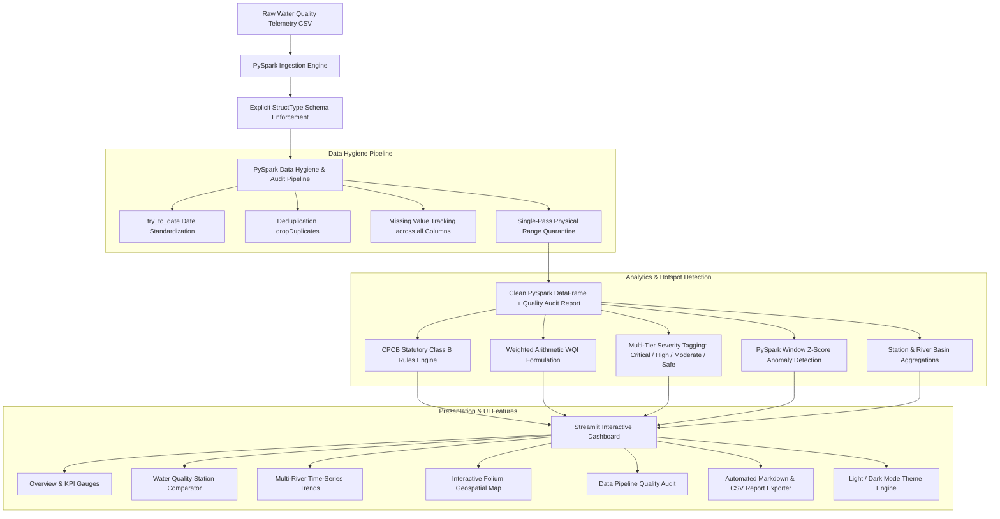

# 🌊 RiverWatch: Indian River Water Quality Analytics & Pollution Hotspot Detection Using PySpark
### *A Big Data Analytics (BDA) College Mini-Project*

[](https://www.python.org/)
[](https://spark.apache.org/)
[](https://streamlit.io/)
[](https://plotly.com/)
[](LICENSE)

---

## 1. Project Abstract
Surface water pollution across major Indian river basins presents an acute ecological and public health emergency. Monitoring systems overseen by the Central Pollution Control Board (CPCB) generate vast spatio-temporal telemetry spanning hundreds of stations, multiple years, and numerous physical, chemical, and microbiological parameters. Traditional desktop tools and spreadsheet-based approaches fail to scale when performing multi-dimensional aggregations, cross-parameter correlation tracking, and longitudinal pollution hotspot detection.

**RiverWatch** is an interactive Big Data Analytics solution leveraging **Apache Spark (PySpark)** and **Streamlit** to process, clean, audit, analyze, and visualize surface water quality across 40 monitoring stations on 10 major Indian rivers (Ganga, Yamuna, Godavari, Krishna, Kaveri, Sabarmati, Narmada, Brahmaputra, Mahanadi, and Sutlej). The project implements an end-to-end distributed data pipeline including schema-enforced CSV ingestion, duplicate eradication, fault-tolerant date standardization, physical range validation, and missing value auditing. It evaluates in-situ water chemistry against statutory CPCB Designated Best Use Class B (Outdoor Bathing) standards to compute a standardized Water Quality Index (WQI), assigns multi-tier hotspot severity classifications, and detects statistical sensor spikes via PySpark Window-partitioned Z-score algorithms. An interactive web dashboard with real-time geospatial mapping, time-series trajectory tracking, and light/dark theme toggles enables intuitive environmental policy analysis and data export.

---

## 2. Problem Statement & Motivation
India's river networks sustain over 1.4 billion people, supporting drinking water, agriculture, industry, and spiritual practices. However, untreated municipal sewage, chemical effluents, and lean non-monsoonal flow have severely degraded river health.

Existing environmental evaluation tools face critical drawbacks:
1. **Unreliable Data Ingestion:** Spreadsheets lack automated schema validation, silently propagating missing values, invalid date formats, and duplicate records.
2. **Computational Inefficiency:** Single-node tools struggle to perform multi-year aggregations across hundreds of monitoring stations.
3. **Opaque Threshold Assessment:** Manual evaluation frequently relies on arbitrary single-parameter cutoffs rather than standardized environmental health criteria (such as CPCB Class B standards) or composite indices (such as WQI).
4. **Lack of Interactive Geospatial Intelligence:** Environmental stakeholders and students often lack accessible, interactive tools to visualize localized pollution severity, track temporal degradation trajectories, and export customized reports.

---

## 3. Existing Problem vs. Proposed Solution

| Dimension | Existing / Traditional Approach | RiverWatch Proposed Solution |
| :--- | :--- | :--- |
| **Data Processing Engine** | Single-threaded Pandas / Excel scripts bound to single-core RAM limits | **Distributed Apache Spark (PySpark)** DataFrame engine with partition parallelism |
| **Data Hygiene & Auditing** | Manual inspection or silent dropping of corrupt records | **Automated PySpark pipeline** reporting missingness %, duplicates, and invalid sensor ranges |
| **Hotspot Classification** | Subjective single-variable thresholding | **Statutory CPCB Class B rule engine** with multi-tier severity (Critical, High, Moderate, Safe) |
| **Water Quality Index** | Absent or unstandardized | **Weighted arithmetic WQI** with dynamic parameter weight renormalization for missing fields |
| **Anomaly Detection** | Static global bounds | **PySpark Window Z-Score** ($> 2.5\sigma$) anomaly detection partitioned by station |
| **User Presentation** | Static static PDF reports or tabular dumps | **Interactive Streamlit Dashboard** with Light/Dark mode, Folium maps, and report export |

---

## 4. System Architecture



---

## 5. Technology Stack
- **Programming Language:** Python 3.12+
- **Distributed Computing Engine:** Apache Spark 4.2.0 (PySpark)
- **Interactive Dashboard:** Streamlit 1.40+
- **Visualizations:** Plotly Express & Plotly Graph Objects
- **Geospatial Mapping:** Folium & streamlit-folium
- **Data Manipulation (Projections):** Pandas & NumPy
- **Automated Testing:** PyTest

---

## 6. Dataset Schema & CPCB Water Quality Standards

### 6.1 CPCB Designated Best Use Standards (Class B Outdoor Bathing)
| Parameter | Unit | CPCB Class B Standard | Hotspot / Critical Trigger |
| :--- | :--- | :--- | :--- |
| **Dissolved Oxygen (DO)** | mg/L | $\ge 5.0$ mg/L | $< 5.0$ mg/L (Critical $< 4.0$ mg/L) |
| **Biochemical Oxygen Demand (BOD)** | mg/L | $\le 3.0$ mg/L | $> 3.0$ mg/L (Critical $> 8.0$ mg/L) |
| **pH** | Standard Units | $6.5 - 8.5$ | $< 6.5$ (Acidic) or $> 8.5$ (Alkaline) |
| **Fecal Coliform (FC)** | MPN / 100 mL | $\le 2,500$ MPN/100 mL | $> 2,500$ MPN/100 mL |
| **Nitrate ($NO_3$)** | mg/L | $\le 10.0$ mg/L | $> 10.0$ mg/L |
| **Turbidity** | NTU | $\le 10.0$ NTU | $> 10.0$ NTU |

### 6.2 Data Schema
| Column Name | PySpark Data Type | Meaning / Unit |
| :--- | :--- | :--- |
| `station_id` | `StringType` | Unique monitoring station identifier code |
| `station_name` | `StringType` | Name of station / landmark (e.g. `Delhi - ITO Bridge`) |
| `river_name` | `StringType` | River basin (e.g. `Ganga`, `Yamuna`, `Godavari`) |
| `state` | `StringType` | Indian State / UT |
| `district` | `StringType` | Administrative district |
| `latitude`, `longitude` | `DoubleType` | Geographic GPS coordinates (WGS84) |
| `sampling_date` | `DateType` | Date of sampling (`YYYY-MM-DD`) |
| `temperature_c` | `DoubleType` | Water temperature in °C |
| `dissolved_oxygen_mg_l` | `DoubleType` | Dissolved oxygen in mg/L |
| `ph` | `DoubleType` | pH value (0 to 14) |
| `conductivity_umhos_cm`| `DoubleType` | Electrical conductivity in µmhos/cm |
| `bod_mg_l` | `DoubleType` | 5-day Biochemical Oxygen Demand in mg/L |
| `nitrate_mg_l` | `DoubleType` | Nitrate concentration in mg/L |
| `fecal_coliform_mpn_100ml`| `LongType` | Microbial coliform count in MPN/100 mL |
| `total_coliform_mpn_100ml`| `LongType` | Total coliform count in MPN/100 mL |
| `turbidity_ntu` | `DoubleType` | Turbidity in NTU |

> **Dataset Provenance Notice**: The included dataset contains realistically simulated observations generated from published CPCB environmental science distributions and accurate geographic coordinates of real monitoring stations. It is clearly labeled as simulated demonstration data for BDA educational purposes and does not represent live telemetry.

---

## 7. Directory Structure
```
RiverWatch/
  app.py                     # Streamlit application with Light/Dark mode & multi-tabs
  requirements.txt           # Python dependency specification
  README.md                  # Comprehensive project documentation
  .gitignore                 # Git ignore file
  data/
    sample_water_quality.csv # 1,600+ records across 40 real Indian river stations
    README.md                # Dataset documentation, CPCB limits, and schema
  src/
    __init__.py
    spark_session.py         # Laptop-optimized SparkSession manager with Windows bindings
    generate_dataset.py      # Realistic CPCB-aligned dataset synthesizer
    data_loader.py           # PySpark DataFrame reader with explicit schema
    preprocessing.py         # PySpark data hygiene, deduplication, and quality audit
    hotspot_detection.py     # CPCB rule engine, WQI calculation, and station ranking
    spark_analytics.py       # Distributed KPIs, basin summaries, and Window Z-Score
    visualizations.py        # Plotly charts and Folium map supporting Light & Dark themes
    report_generator.py      # Automated markdown analytical report and CSV exporter
  tests/
    __init__.py
    test_preprocessing.py    # PyTest tests for cleaning, audit, and filtering
    test_hotspot_detection.py# PyTest tests for CPCB rules, WQI, and missing data handling
  reports/
    project_report_template.md # Complete academic project report template
    presentation_outline.md    # 12-slide viva presentation deck outline
```

---

## 8. Installation & Execution Guide

### 8.1 Prerequisites
1. **Python:** 3.10, 3.11, or 3.12 installed.
2. **Java Runtime:** Java 11, 17, or 21+ installed (required by Apache Spark). Verify via `java -version`.

### 8.2 Installation
Clone or navigate to the project directory:
```bash
cd "d:/D'monte BDA"
```

Install the dependencies:
```bash
pip install -r requirements.txt
```

### 8.3 Running the Interactive Dashboard
Launch Streamlit using:
```bash
streamlit run app.py
```
Open your browser at `http://localhost:8501`.

### 8.4 Running Automated Tests
Run the comprehensive PyTest test suite:
```bash
python -m pytest tests/ -v
```
All 6 unit tests should report `PASSED`.

---

## 9. Key Dashboard Features & Instructions

### 🌓 1. Light / Dark Mode Toggle
Located at the very top of the sidebar. Instantly toggles between:
- **Dark Mode:** Deep slate-navy palette (`#0b1329`), glowing accents, and `CartoDB dark_matter` map tiles.
- **Light Mode:** Crisp, clean white styling (`#ffffff`), high contrast text, and `CartoDB positron` map tiles.

### 🌐 2. Overview Tab
- **Executive KPI Cards:** Total records, monitoring stations, river basins, flagged observations, and average WQI.
- **Chemistry Health Cards:** In-situ BOD and DO compared against statutory CPCB limits.
- **River Basin Leaderboard:** Aggregated comparative metrics across all basins.
- **Severity Donut:** Distribution of samples across Critical, High Priority, Moderate, and Safe categories.

### 🔍 3. Water Quality Explorer Tab
- **Side-by-Side Comparator:** Select any two monitoring stations to inspect comparative mean, min, and max readings side-by-side.
- **Station Ranking Bar Chart:** Compare top stations ranked by BOD, DO, or WQI.
- **Interactive Data Table:** Filterable, searchable raw observations with color-coded severity badges.

### 📈 4. Trend Analysis Tab
- **Multi-River Monthly Trends:** Plot time-series trajectories for any parameter with statutory CPCB reference lines.
- **Correlation Heatmap:** Visualizes physical-chemical interactions (e.g. inverse relationship between high organic BOD and low DO).
- **PySpark Window Z-Score Anomaly Detector:** Spot statistical sensor spikes exceeding $2.5\sigma$ from local station baselines.

### 🚨 5. Hotspot Detection & Map Tab
- **Interactive Folium Map:** Mapped stations centered on India with color-coded markers (Red = Critical, Orange = High, Yellow = Moderate, Green = Safe). Click any marker for detailed popup statistics.
- **Ranked Hotspots Table:** Stations prioritized by critical violation count, non-compliance rate, and lowest WQI.

### 🛡️ 6. Data Quality Audit Tab
- **Pipeline Health Score:** Quantified data integrity percentage.
- **Duplicates & Range Anomalies:** Transparent counts of duplicate records dropped and out-of-range sensor readings sanitized.
- **Missing Value Breakdown:** Column-by-column missingness counts and percentages.

### 📑 7. Insights & Reports Tab
- **Automated Narrative Findings:** AI-style data-driven executive findings.
- **Downloadable Markdown Report:** Download the complete academic analysis report (`.md`).
- **Downloadable Filtered Data:** Export the active filtered slice as CSV.
- **PySpark Benchmark Generator:** Synthesize 5,000+ records to benchmark distributed execution speed on your laptop!

---

## 10. Limitations & Future Scope
- **Current Limitations:** The included sample dataset uses realistic environmental simulations based on CPCB monitoring parameters rather than live telemetry. Spark runs in local standalone mode.
- **Future Scope:**
  - Real-time stream ingestion using Apache Kafka connected to IoT surface water probes.
  - Predictive modeling using PySpark MLlib (Random Forest Regressor) to forecast 7-day biochemical oxygen demand spikes based on weather forecasts and industrial discharge schedules.

---

## 11. Conclusion
RiverWatch demonstrates that Big Data Analytics and distributed computing with Apache Spark can be effectively combined with modern interactive web technologies to deliver rigorous, transparent, and user-friendly environmental intelligence for Indian river water conservation.
